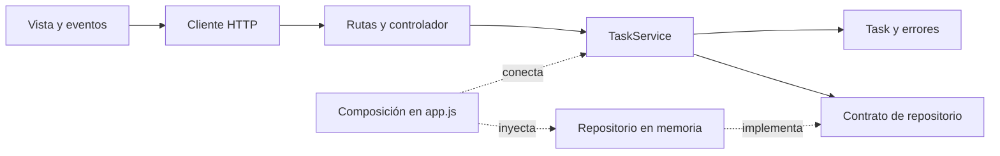

# Guía 5 - Arquitectura y organización del software

Aprendiz: Julián Felipe Carvajal Caballero

Ficha: 3171618

GitHub: @julianfelipecarvajalcaballero-art
SENA - ADSO
Instructor: Cristian González

## 3.1 Preguntas iniciales

**¿Qué problemas habría al cambiar una regla de negocio en un archivo de 3.000 líneas?**

Sería complicado encontrar qué parte hay que cambiar. Como todo está junto, uno puede arreglar una cosa y dañar otra sin darse cuenta. También tocaría revisar bastante código para entender cómo funciona.

**¿Cómo afectaría el trabajo en equipo?**

Si varias personas trabajan en el mismo archivo, se pueden cruzar los cambios. Sería difícil repartir el trabajo porque todos estarían tocando casi lo mismo.

**¿Cómo influye el orden del código en la calidad?**

Si el código está organizado, es más fácil entenderlo, probarlo y corregir errores. Si todo está mezclado, hasta un cambio pequeño termina tomando más tiempo.

## 3.2 Conceptos

- **Separación de responsabilidades:** que cada parte del código se encargue de algo concreto.
- **Arquitectura por capas:** separar la interfaz, las reglas de la aplicación y el acceso a los datos.
- **MVC:** dividir el proyecto en modelo, vista y controlador. El modelo maneja datos y reglas, la vista muestra la información y el controlador recibe las acciones.
- **Clean Architecture:** organizar el proyecto para que las reglas principales no dependan directamente de Express o de una base de datos.
- **Modularidad:** dividir el código en partes que se puedan entender y trabajar por separado.
- **Cohesión:** que lo que hay dentro de un módulo tenga relación con su función.
- **Acoplamiento:** qué tanto depende una parte de otra. Si hay mucha dependencia, cambiar algo puede afectar varias partes.
- **Deuda técnica:** problemas que se van dejando en el código y que después hacen más difícil seguir trabajando.

## 3.3 Pasos de la refactorización

La idea es revisar qué está haciendo cada archivo y separar lo que está mezclado. Después se organizan los modelos, los servicios, los controladores y el repositorio. Al final se prueba que la aplicación siga funcionando.

## 3.4 Taller práctico

La base es el gestor de tareas del repositorio del profesor:
https://github.com/crgonzalez3212/Guia5Arquitectura

Versión usada: `cd058008b786008ea76703589ffa98c45a5bc63f`.

### Problemas encontrados

El backend ya venía dividido en varios archivos. Lo que se mejoró fue la separación de algunas funciones:

1. En `frontend/src/app.js` estaban las peticiones a la API, el HTML de las tareas y los eventos de los botones. Se separaron en `api.js`, `view.js` y `app.js` para que cada archivo tenga su función.
2. En `taskService.js` se usaban códigos HTTP como 400 y 404. Se cambiaron por errores de validación y de tarea no encontrada. La parte HTTP es la que decide qué código devolver.
3. El repositorio guardaba las tareas, creaba los objetos y además tenía los datos de ejemplo. Ahora el servicio crea la tarea, el repositorio la guarda y los ejemplos se cargan desde `app.js`.
4. `server.js` configuraba todo y también arrancaba el servidor. Se separó la configuración en `app.js` para poder hacer pruebas sin abrir un puerto apenas se importa el archivo.
5. El listado devolvía una copia del arreglo, pero las tareas seguían siendo los mismos objetos. Ahora también se copian para evitar que se cambien los datos por fuera del repositorio.

### Organización del proyecto

Se usó una estructura basada en Clean Architecture. Las carpetas quedaron así:

```text
backend/
  src/
    domain/
      Task.js
      errors.js
    application/
      TaskService.js
    infrastructure/
      InMemoryTaskRepository.js
    interfaces/http/
      taskController.js
      taskRoutes.js
    app.js
    server.js
  test/tasks.test.js
frontend/
  index.html
  styles.css
  src/
    api.js
    view.js
    app.js
```




`Task` representa una tarea. `TaskService` maneja las operaciones de crear, listar y cambiar el estado. El controlador recibe las peticiones y el repositorio guarda los datos.

El repositorio se le pasa al servicio al crearlo. Así se puede probar el servicio con otro repositorio sin cambiar su código. Por ahora funciona en memoria. Si se conecta una base de datos con operaciones asíncronas, también habría que adaptar las llamadas del servicio y del controlador.

### Cómo ejecutar

Desde la carpeta `backend`:

```sh
npm ci
npm test
npm start
```

Después se abre http://localhost:3000.

La aplicación permite listar tareas, crear una nueva y cambiar su estado. El título debe tener al menos tres caracteres sin contar los espacios de los extremos. Los estados son pendiente, en progreso y finalizada.

Se conservaron estas rutas:

- `GET /api/health`
- `GET /api/tasks`
- `POST /api/tasks`
- `PATCH /api/tasks/:id/status`

Los datos se borran cuando se apaga el servidor porque todavía se guardan en memoria.

### Pruebas

Se ejecutaron tres pruebas automáticas y las tres pasaron:

1. Crear una tarea con un repositorio de prueba y revisar que se valide el título y que inicie pendiente.
2. Cambiar el estado, rechazar estados incorrectos, buscar una tarea que no existe y revisar que el listado no permita cambiar los datos guardados por fuera del repositorio.
3. Probar las rutas HTTP, las respuestas de error y la entrega de los archivos del frontend.

También se probó desde el navegador: se creó la tarea Verificar entrega, se cambió a finalizada y se intentó crear otra con solo espacios en el título. La aplicación mostró el error correspondiente.

La captura está en `docs/verificacion-interfaz.png`.

## 3.5 Revisión de código

**¿Cómo se redujo el acoplamiento?**

Se separaron las peticiones, la vista y los eventos del frontend. En el backend, el servicio dejó de manejar códigos HTTP y recibe el repositorio como dependencia. Así cada parte necesita conocer menos detalles de las otras.

**¿Por qué esto ayuda a la calidad del software?**

Porque es más fácil revisar una parte sin tener que entender toda la aplicación. También se pueden probar las reglas por separado y encontrar más rápido dónde está un error.

El trabajo quedó en este repositorio:
https://github.com/julianfelipecarvajalcaballero-art/Guia5Arquitectura

En `main` está la base y en `refactor/arquitectura` están los cambios.

Pull Request para la revisión:
https://github.com/julianfelipecarvajalcaballero-art/Guia5Arquitectura/pull/1

Se envió la invitación de colaborador al profesor, `crgonzalez3212`. Falta que la acepte para poder seleccionarlo como revisor. El Pull Request sigue abierto.

## 3.6 Conclusión

Separar el código ayuda a que el proyecto se entienda mejor y sea más fácil de corregir. La aplicación sigue haciendo lo mismo, pero ahora cada archivo tiene una función más clara y las pruebas permiten revisar que los cambios no dañen lo que ya funciona.

## Fuentes

- Guía de aprendizaje 5 entregada por el profesor.
- Repositorio base de Cristian González, enlazado en el punto 3.4.
