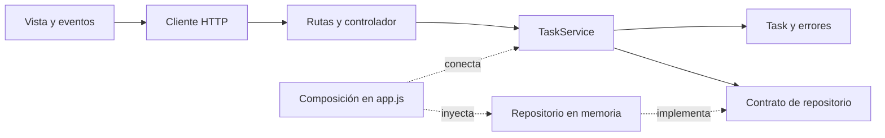

# Guía 05: Arquitectura y organización del software

SENA - ADSO. Instructor: Cristian González. Fecha: 19 de octubre de 2026.
Agregar nombres de los integrantes y ficha antes de entregar.

## 3.1 Contextualización

Modificar una regla de negocio en un archivo de 3.000 líneas que mezcla SQL, interfaz y validaciones aumenta el riesgo de afectar funciones ajenas al cambio. Es difícil localizar errores y probar cada responsabilidad por separado.

En equipo se producirían conflictos frecuentes al editar el mismo archivo, revisiones extensas y dificultad para distribuir tareas. Separar responsabilidades facilita comprender el código, detectar regresiones y mantener la aplicación.

La organización interna influye en la calidad porque permite verificar reglas aisladas, reemplazar componentes y corregir errores con un alcance controlado.

## 3.2 Conceptualización

| Concepto | Explicación |
| --- | --- |
| Separación de responsabilidades | Cada módulo tiene una función definida y un motivo claro para cambiar. |
| Arquitectura por capas | Agrupa presentación, negocio y persistencia con límites explícitos. |
| MVC | El modelo representa datos y reglas; la vista presenta información; el controlador atiende acciones. |
| Clean Architecture | Las políticas del negocio son independientes de frameworks, interfaces y almacenamiento. |
| Modularidad | División del sistema en componentes con contratos claros. |
| Cohesión | Relación entre las funciones de un módulo. Es alta cuando todas sirven al mismo propósito. |
| Acoplamiento | Dependencia entre componentes. La inyección de dependencias facilita sustituir implementaciones. |
| Deuda técnica | Costo futuro de decisiones que dificultan mantener el sistema. |

## 3.3 Demostración

Procedimiento de referencia, sin afirmar asistencia a una demostración: identificar responsabilidades mezcladas, extraer entidades y servicios, aislar persistencia y presentación, conectar mediante inyección de dependencias y verificar las reglas con un repositorio sustituto.

## 3.4 Taller práctico

Fuente: https://github.com/crgonzalez3212/Guia5Arquitectura

Commit analizado: cd058008b786008ea76703589ffa98c45a5bc63f.

El backend original ya tenía controlador, servicio, repositorio e inyección por constructor. No corresponde describirlo como un monolito sin separación. Los hallazgos reales son:

| Evidencia original | Problema | Solución |
| --- | --- | --- |
| frontend/src/app.js contiene fetch, HTML y eventos. | Mezcla transporte, presentación y coordinación. | Extraer api.js y view.js. |
| taskService.js asigna statusCode 400 y 404. | El negocio conoce HTTP. | Errores ValidationError y NotFoundError traducidos por el adaptador HTTP. |
| taskRepository.js construye entidades y carga ejemplos. | Mezcla almacenamiento, creación del modelo y configuración inicial. | El servicio construye Task; app.js configura semillas; el repositorio almacena. |
| server.js configura e inicia el servidor. | Importarlo para probar abre un puerto. | Separar createApp y server.js. |
| findAll copia el arreglo pero comparte sus objetos. | Se puede alterar el almacenamiento sin usar sus operaciones. | Devolver copias de los objetos. |

### Estructura propuesta e implementada

```text
backend/
  src/
    domain/
      Task.js
      errors.js
    application/
      TaskService.js
    infrastructure/
      InMemoryTaskRepository.js
    interfaces/http/
      taskController.js
      taskRoutes.js
    app.js
    server.js
  test/tasks.test.js
frontend/
  index.html
  styles.css
  src/
    api.js
    view.js
    app.js
```



Es una estructura inspirada en Clean Architecture. El servicio no importa Express ni el repositorio concreto. En JavaScript el contrato del repositorio es estructural: findAll(), create(task), findById(id) y updateStatus(id, status). Las operaciones son síncronas; una futura base de datos asíncrona requerirá adaptar el contrato y sus consumidores.

La entidad representa la tarea; el servicio coordina creación y cambio de estado; el controlador recibe peticiones; el repositorio almacena. app.js es el punto de composición que conoce las implementaciones.

### Comportamiento y ejecución

Se mantienen GET /api/health, GET y POST /api/tasks y PATCH /api/tasks/:id/status. El título exige tres caracteres después de quitar espacios. Los estados admitidos son pendiente, en progreso y finalizada. Las tareas nuevas inician pendientes.

Desde backend, con Node.js y npm disponibles:

```sh
npm ci
npm test
npm start
```

Abrir http://localhost:3000. La interfaz ahora se sirve desde Express y usa /api/tasks sin fijar la dirección del servidor. El puerto puede configurarse con PORT. Los datos siguen en memoria y se pierden al detener el proceso.

### Verificación ejecutada

Resultado real: tres pruebas aprobadas y cero fallidas con node --test.

1. Negocio con repositorio sustituto: normalización del título, creación de entidad, estado inicial y rechazo de título corto, sin requerir servidor ni almacenamiento concreto.
2. Estados y repositorio: actualización válida, estado inválido, tarea inexistente y protección contra modificaciones externas de los datos devueltos.
3. Integración HTTP: salud, listado vacío, creación 201, actualización, errores 400 y 404, entrega del HTML y del módulo del cliente.

La interfaz se verificó en navegador: conexión con API, creación de la tarea Verificar entrega, cambio a finalizada y rechazo de un título compuesto por espacios. La captura real se incluye en docs/verificacion-interfaz.png.

## 3.5 Socialización y revisión

La revisión corresponde a Cristian según la indicación recibida. No se registra una aprobación todavía inexistente.

Se redujo el acoplamiento retirando HTTP del servicio, inyectando almacenamiento y separando transporte, vista y eventos. La nueva estructura facilita el aseguramiento de calidad porque permite pruebas aisladas, módulos pequeños y cambios con responsabilidades identificables.

Propuesta para los 15 minutos: tres minutos de hallazgos, cuatro del diagrama, cuatro de ejecución y pruebas, y cuatro de preguntas del instructor.

### Publicación y revisión en GitHub

- Repositorio publicado en la cuenta del aprendiz: https://github.com/julianfelipecarvajalcaballero-art/Guia5Arquitectura.
- main conserva la base; refactor/arquitectura contiene la solución.
- Pull Request abierto: https://github.com/julianfelipecarvajalcaballero-art/Guia5Arquitectura/pull/1.
- Invitación de colaborador con permiso de escritura enviada a crgonzalez3212; pendiente de aceptación.
- GitHub rechazó la asignación formal de revisor porque todavía no ha aceptado la invitación. Cuando la acepte, solicitar su revisión desde Reviewers.
- No fusionar antes de recibir y atender las observaciones reales del instructor.

Lista para la revisión:

- [ ] Servicio sin dependencias de Express ni almacenamiento concreto.
- [ ] Controladores sin reglas de negocio ni persistencia.
- [ ] Repositorio dedicado al almacenamiento.
- [ ] Transporte, vista y eventos separados.
- [x] Pruebas aprobadas y verificación manual realizada.
- [x] Diagrama consistente con el código.
- [x] Instructor invitado como colaborador.
- [ ] Invitación aceptada y asignación formal como revisor completada.
- [ ] Observaciones reales atendidas.

## 3.6 Cierre

La calidad arquitectónica depende de límites verificables, además de organizar carpetas. La refactorización conserva las funciones del gestor y mejora la independencia del negocio, la cohesión y la facilidad de prueba. El almacenamiento en memoria sigue siendo una limitación explícita.

## Referencias

- Guía de aprendizaje 05, SENA, documento suministrado.
- Repositorio Guia5Arquitectura, commit identificado arriba.
- Martin, R. C. (2017). Clean Architecture. Prentice Hall. Referencia conceptual de la guía.
- Fowler, M. (2018). Refactoring, segunda edición. Addison-Wesley. Referencia conceptual de la guía.
